<div align="center">

# 🌌 BHUVANESWARAN S
### Software Developer &bull; AI Engineer &bull; GenAI Developer

[](https://react.dev/)
[](https://www.typescriptlang.org/)
[](https://vitejs.dev/)
[](https://tailwindcss.com/)
[](https://threejs.org/)
[](https://www.framer.com/motion/)

<br />

> **"Engineering Intelligence. Building the Future."**  
> *A high-performance, futuristic personal portfolio engineered to showcase production AI architectures, full-stack systems, Flutter mobile applications, and low-latency performance engineering.*

<br />

[Explore Portfolio](#-portfolio-sections) &bull; [Key Highlights](#-verified-engineering-highlights) &bull; [Tech Arsenal](#%EF%B8%8F-technical-arsenal) &bull; [Projects](#-featured-projects) &bull; [Quickstart](#-getting-started) &bull; [Contact](#-connect--collaborate)

</div>

---

## ⚡ Verified Engineering Highlights

| Metric | Achievement | Impact |
| :--- | :--- | :--- |
| **13+ Applications** | Production Flutter Mobile Apps | Shipped across healthcare, fintech, social, and utility domains with 60 FPS fluid rendering. |
| **3 Platforms** | Responsive Flutter Web Apps | Engineered cross-platform client portals with real-time state machines and responsive layouts. |
| **98 ms Latency** | Superbill Menu Optimization | Slashed navigation delay from **~1000ms (1.7s peak) down to 98ms** (>90% latency reduction). |
| **94% Autonomous** | Voice AI Call Resolution | Engineered ElevenLabs-style conversational caller with real-time interruption (barge-in). |
| **92% Precision** | RAG Pipeline Accuracy | Deployed Python RAG ingestion with OpenAI and Ollama (Llama 3.1) vector indexing. |
| **8.5 CGPA** | B.Tech in Computer Science | Dr. M.G.R. Educational and Research Institute (Distinction graduate). |

---

## 🔮 Interactive Digital Experience & Features

- **🌐 Interactive 3D AI Orb**: Real-time Three.js canvas featuring a glowing luminous core, outer wireframe icosahedron, orbital particle rings, and mouse-parallax physics.
- **🤖 Bhuvaney AI Assistant**: Floating AI copilot in the bottom-right corner powered by a structured local knowledge base answering questions about technical skills, projects, and career milestones.
- **⚡ Interactive Latency Benchmark**: Live before-and-after bar comparison visualizing the Superbill optimization from ~1000ms down to 98ms.
- **🎯 Dynamic Custom Cursor**: Desktop cursor with smooth spring trail physics that adapts over interactive elements.
- **📱 Fluid Glassmorphism & Cyber Aesthetics**: Tailwind CSS v4 styling with electric purple (`#8B5CF6`), indigo (`#6366F1`), and cyan (`#22D3EE`) ambient neon glow.
- **📄 Instant Resume Delivery**: Direct download link to verified PDF resume (`public/bhuvanesh_resume.pdf`).
- **🎉 Confetti Feedback**: Celebratory particle bursts on successful contact inquiries.

---

## 🛠️ Technical Arsenal

```mermaid
graph TD
    AI["🧠 AI & Generative AI"] --> LLM["LLMs & OpenAI API"]
    AI --> RAG["RAG Pipelines & Embeddings"]
    AI --> Agents["LangChain & AI Agents"]
    AI --> Local["Ollama (Llama 3.1) & HuggingFace"]

    BE["⚙️ Backend & Architecture"] --> Fast["FastAPI & WebSockets"]
    BE --> Django["Django & REST Framework"]
    BE --> DB["PostgreSQL & Firebase"]

    FE["📱 Mobile & Frontend"] --> Flutter["Flutter & Dart (13+ Apps)"]
    FE --> React["React 19 & TypeScript"]
    FE --> Web["Tailwind CSS v4 & Three.js"]

    DevOps["🚀 Platforms & Tools"] --> Git["Git & GitHub Actions"]
    DevOps --> Docker["Docker Containers"]
    DevOps --> Vercel["Vercel Edge Deployment"]
```

<div align="center">



</div>

### Detailed Competencies:
- **Programming Languages**: Python, Dart, TypeScript, JavaScript
- **AI & GenAI**: Large Language Models (LLMs), Prompt Engineering, RAG Architectures, LangChain, OpenAI API, Ollama (Llama 3.1), Hugging Face, ElevenLabs Voice AI, Dynamic Tool Calling
- **Backend**: FastAPI (AsyncIO), Django & DRF, WebSockets, REST APIs, PostgreSQL, Firebase
- **Frontend & Mobile**: Flutter (BLoC / Provider), React 19, Tailwind CSS v4, Next.js, HTML5/CSS3
- **Tools & DevOps**: Git, GitHub, Docker, Postman, Cursor AI, VS Code, Vercel

---

## 🚀 Featured Projects

### 1. 💼 Jobify — AI-Powered Recruitment Platform
> *An AI-powered recruitment ecosystem designed to simplify job discovery, resume analysis, and candidate-job matching.*
- **Live Demo**: [https://jobify-kappa-pearl.vercel.app/](https://jobify-kappa-pearl.vercel.app/) *(Demo login: `bhu@gmail.com` / `pass 123456`)*
- **Features**: 13-section interactive resume builder, semantic ATS scoring, candidate-to-job matching with 90% accuracy, automated skill gap roadmaps.
- **Tech Stack**: Flutter, Python, FastAPI, Firebase, OpenAI API, Next.js
- **Architecture**: `Frontend (Flutter/Next.js) → FastAPI Gateway → OpenAI Async Semantic Engine → Firebase Storage`

---

### 2. 🔍 Auto Code Reviewer — LLM Developer Productivity
> *An autonomous pull request analysis platform that evaluates code diffs and leaves contextual review comments.*
- **Features**: GitHub API webhook integration, inline review comments, AST parsing, functional issue detection, security & performance auditing.
- **Tech Stack**: Python, FastAPI, GitHub API, OpenAI API, React.js
- **Architecture**: `GitHub Webhook → FastAPI Worker → AST Diff Parser → LLM Audit Chains → GitHub PR Comments API`

---

### 3. ⚡ Superbill Performance Overhaul — Sub-100ms Navigation
> *Healthcare billing navigation performance leap from ~1.7s blocking delay down to 98 milliseconds.*
- **Key Breakthrough**: Profiled widget render trees, eliminated synchronous data transforms into background isolates, implemented reactive state memoization.
- **Tech Stack**: Flutter, Dart, Performance Profiling, BLoC Architecture

---

### 4. 🍽️ Foode — Multi-Zone Dining & Operations Platform
> *Comprehensive restaurant operations, delivery logistics, and customer experience platform.*
- **Features**: Spatial floor planning (tables, private rooms, halls, terrace), live order state machines, scheduled takeaways, dine-out preorders, automated billing.
- **Tech Stack**: Flutter, Dart, Django, Django REST Framework, PostgreSQL

---

### 5. 🎙️ Agentic Voice AI Caller — Autonomous Voice Streamer
> *ElevenLabs-style conversational voice caller with low latency and real-time interruption handling.*
- **Features**: Full-duplex WebSockets audio streaming, sub-250ms barge-in cutoff, dynamic tool calling for live CRM lookup, 94% autonomous resolution.
- **Tech Stack**: Python, FastAPI, WebSockets, ElevenLabs, Twilio, OpenAI API

---

## 📂 Repository Structure

```text
personal_site/
├── public/
│   ├── bhuvanesh_resume.pdf       # Verified downloadable resume PDF
│   └── favicon.svg                # Cyberpunk neon monogram emblem
├── src/
│   ├── assets/                    # Project graphics & icons
│   ├── components/
│   │   ├── About/                 # Profile overview & verified statistics cards
│   │   ├── Achievements/          # Section 7: Key impact & engineering highlights
│   │   ├── AIChat/                # "Bhuvaney AI" assistant & knowledge modal
│   │   ├── Contact/               # Interactive inquiry form & direct channels
│   │   ├── CurrentFocus/          # "What I'm Exploring Now" R&D cards
│   │   ├── Education/             # B.Tech CS degree & distinction badge
│   │   ├── Experience/            # Vertical animated career timeline
│   │   ├── Footer/                # Minimalist cyber footer
│   │   ├── GitHub/                # Repository showcase & GitHub integration
│   │   ├── Hero/                  # Hero section & Three.js 3D AI Orb
│   │   ├── Navbar/                # Sticky blurred navigation & mobile drawer
│   │   ├── Projects/              # Filterable project showcase & modal inspector
│   │   └── UI/                    # Cursor, particles canvas, headings & buttons
│   ├── data/                      # Centralized data files for easy updates
│   │   ├── personal.ts            # Bio, name, status, role definitions
│   │   ├── experience.ts          # Employment history & accomplishments
│   │   ├── skills.ts              # Categorized tech inventory
│   │   ├── projects.ts            # Detailed project case studies
│   │   ├── education.ts           # University details & coursework
│   │   └── social.ts              # Verified GitHub, LinkedIn, email & phone
│   ├── types/                     # Strict TypeScript interfaces
│   ├── App.tsx                    # Top-level composition
│   ├── index.css                  # Tailwind CSS v4 directives & glassmorphic utilities
│   └── main.tsx                   # Application bootstrap
├── package.json                   # Dependencies & build scripts
├── tsconfig.json                  # Strict TypeScript configuration
├── vite.config.ts                 # Vite 8 & Tailwind v4 plugin setup
└── README.md                      # Documentation & showcase
```

---

## 💻 Getting Started

### Prerequisites
- **Node.js**: v18.0.0 or higher
- **npm** or **pnpm** / **yarn**

### 1. Clone the Repository
```bash
git clone https://github.com/Bhuvo/profile.git
cd profile
```

### 2. Install Dependencies
```bash
npm install
```

### 3. Run Development Server
```bash
npm run dev
```
Open **[http://localhost:5173](http://localhost:5173)** in your browser.

### 4. Build for Production
```bash
npm run build
```
Generates an optimized, minified production bundle in the `dist/` directory.

### 5. Preview Production Build
```bash
npm run preview
```

---

## ☁️ Deploy to Vercel

Deploying this portfolio to **Vercel** takes less than 60 seconds:

[](https://vercel.com/new/clone?repository-url=https://github.com/Bhuvo/profile)

### Manual Steps:
1. Import the repository in [Vercel Dashboard](https://vercel.com/new).
2. Framework Preset will automatically detect **Vite**.
3. Keep default settings (`Build Command: npm run build`, `Output Directory: dist`).
4. Click **Deploy**.

---

## 📬 Connect & Collaborate

- **Name**: Bhuvaneswaran S
- **Location**: Chennai, India
- **LinkedIn**: [linkedin.com/in/bhuvaneswaran-s-69195b420](https://www.linkedin.com/in/bhuvaneswaran-s-69195b420/)
- **GitHub**: [github.com/Bhuvo](https://github.com/Bhuvo)
- **Email**: [bhuvaneswarand15@gmail.com](mailto:bhuvaneswarand15@gmail.com)
- **Phone**: +91 70923 39477

---

<div align="center">
<sub>Designed and engineered with passion &bull; © 2026 Bhuvaneswaran S. All rights reserved.</sub>
</div>
